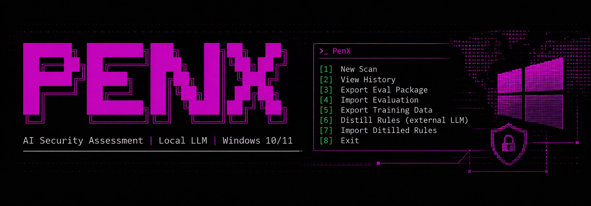
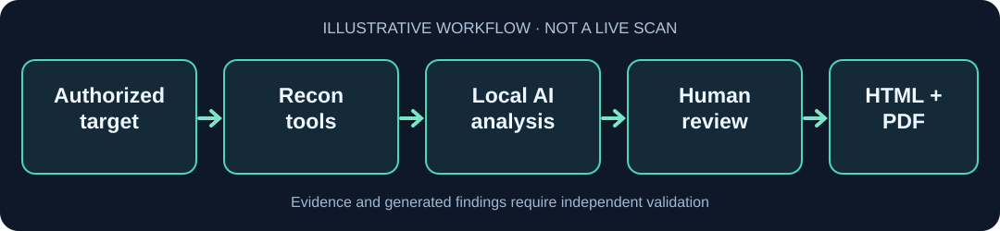

  

<h1 align="center">PenX</h1>

<strong>Windows-first security reconnaissance. Local AI. Evidence you can review.</strong>

  PenX is an open-source terminal application that brings <strong>Nmap, Nuclei, httpx, ffuf, Subfinder, Katana</strong> and more into one security assessment workflow—with local LLM assistance and shareable reports.

  
  
  
  
  
  

  <a href="#download"><strong>Download for Windows</strong></a> ·
  <a href="#quick-start"><strong>Quick start</strong></a> ·
  <a href="docs/DEMO.md"><strong>View demo</strong></a> ·
  <a href="#documentation"><strong>Documentation</strong></a>

  <a href="#why-penx">Features</a> ·
  <a href="#supported-scanners">Scanners</a> ·
  <a href="#local-ai-and-privacy">Local AI</a> ·
  <a href="#reports-and-exports">Reports</a> ·
  <a href="#safety-and-limitations">Safety</a>

> [!IMPORTANT]
> **Authorized targets only.** PenX makes real network requests. Use it only on systems you own or are explicitly permitted to assess. AI-generated findings and CVE matches are **not proof of a vulnerability**—always review the underlying evidence.
>
> **Release status (21 October 2026):** [v0.4.10](https://github.com/spk-c/PenX/releases/tag/v0.4.10) has published Windows installer, portable ZIP and SHA-256 checksums. Independent Windows/scanner and historical-database [field acceptance](docs/MAINTENANCE_STATUS.md) remains **not signed off**.

## Download

**The easiest way to get started is the Windows installer.** Use the [latest official GitHub Release](https://github.com/spk-c/PenX/releases/latest) for the newest *published* build:

| Edition | Recommended for | Get it |
| --- | --- | --- |
| **Windows installer** (`PenX-Setup-x64.exe`) | Most Windows 10/11 users; Start menu and uninstall entry | **[Download installer](https://github.com/spk-c/PenX/releases/latest/download/PenX-Setup-x64.exe)** |
| **Portable ZIP** (`PenX-Windows-x64.zip`) | Running PenX from an extracted directory | **[Download portable ZIP](https://github.com/spk-c/PenX/releases/latest/download/PenX-Windows-x64.zip)** |
| **Source code** | Developers and Python-based installations | [Install from source](#from-source) |

**Verify your download:** Compare the file against [SHA256SUMS.txt](https://github.com/spk-c/PenX/releases/latest/download/SHA256SUMS.txt) from the same release. Extract the **complete portable ZIP**, including `_internal`; GitHub's auto-generated *Source code (ZIP)* is **not** the packaged Windows app.

> [!NOTE]
> The installer is **not Authenticode-signed** and may trigger Windows SmartScreen. Third-party scanner binaries and local AI models are **not bundled**. Read the [Windows installation guide](WINDOWS.md) before installing extra dependencies.

## Why PenX?

| Capability | What you get |
| --- | --- |
| **12 scanner adapters** | Port, service, web, DNS, subdomain and TLS reconnaissance in one terminal menu |
| **Local AI assistance** | Use your own OpenAI-compatible local LLM endpoint (LM Studio, Ollama or llama.cpp) |
| **Evidence-based review** | Scanner context, human corrections, version-aware CVE candidates and source checks |
| **Scope-aware scanning** | Passive-Only Recon, bounded active tools with consent, and separate opt-in endpoint mapping |
| **History and comparison** | Locally saved assessments, corrections and scan differences over time |
| **Report generation** | HTML/PDF reports plus saved-session JSON and SARIF 2.1.0 exports |

**PenX is a terminal/CLI application**, not a graphical dashboard or an exploitation framework. It is an independent Windows-first adaptation of the MIT-licensed [METATRON project](https://github.com/sooryathejas/METATRON).

## Quick start

### Installer or portable ZIP

1. [Download PenX](#download) and verify its checksum.
2. Run `PenX-Setup-x64.exe`, or extract the whole portable ZIP and run `PenX.exe`.
3. Follow the optional scanner setup. Some dependencies require internet access, `winget` or administrator approval (such as Npcap).
4. For AI-assisted assessments, configure a compatible local model API. No model is included; local inference is optional.
5. Choose **[1] New Scan**, enter an **authorized** IP/domain, select scan tools and review the findings.

Useful diagnostics from a portable executable folder:

~~~powershell
.\PenX.exe --setup-status  # Check setup; does not scan or download
.\PenX.exe --setup         # Interactive scanner setup
.\PenX.exe --llm-setup     # Optional local model setup
.\PenX.exe --check         # Local diagnostics
~~~

### From source

Windows source installation supports Python **3.10–3.13** (3.13 recommended):

~~~powershell
git clone https://github.com/spk-c/PenX.git
cd PenX
.\install-windows.bat
.\start-windows.bat
~~~

Setup prepares the Python environment and handles supported scanner setup with consent. Use `check-windows.bat` for diagnostics and `install-scanners.bat` to retry missing scanners. **Back up** existing `.env`, `data/` and `reports/` before updating. [Windows troubleshooting →](WINDOWS.md)

## How PenX works

~~~text
Authorized target
     │
     ▼
Choose scope and scanners
     │
     ▼
Collect scanner evidence
     │
     ├──► Optional local AI and CVE research
     │
     ▼
Human review / corrections
     │
     ▼
Saved history ──► HTML · PDF · JSON · SARIF
~~~

*Illustration, not a live scan recording. The [demo guide](docs/DEMO.md) also shows how to generate sample reports from synthetic data without scanning a host.*

## Supported scanners

PenX provides **12 scanner adapters** and one separate **[e] endpoint-mapping workflow**. Tools with missing dependencies or failures are reported as unavailable—not silently marked successful.

| Key | Scanner | Purpose |
| :---: | --- | --- |
| `1` | **Nmap** | Ports, services, product and CPE evidence; some modes need Npcap |
| `2` | **WHOIS** | Domain registration data |
| `3` | **WhatWeb** | Web technology detection; labeled limited fallback |
| `4` | **HTTP headers** | Response and security header inspection |
| `5` | **DNS** | DNS record lookups |
| `6` | **Nikto** | Optional web-server checks |
| `7` | **Nuclei** | Bounded HTTP/TLS template checks with consent |
| `8` | **ProjectDiscovery httpx** | HTTP probing and technology information |
| `9` | **ffuf** | Bounded path discovery |
| `s` | **Subfinder** | Passive subdomain inventory; no automatic follow-up scans |
| `c` | **Katana** | Bounded same-host crawling with consent |
| `d` | **TLS check** | Certificate and TLS handshake checks, not a full cipher audit |
| `e` | **Endpoint mapping** *(separate)* | Opt-in Katana → ffuf same-origin workflow |

### Scan presets

~~~text
[0] Passive-Only Recon             External source lookups; no active probes
[a] Standard Scan                  Tools 1–5
[n] Standard Scan + Nikto          Tools 1–6
[x] Full Scan                      All 12; active checks require consent
[1–9, s, c, d, e]                  Individual selections
[Esc]                              Back
~~~

For example, enter `1 4 8 s d` to select five tools. The separate **[e] workflow is never included in Full Scan**. Passive-Only Recon may still contact external lookup services. Active tools such as Nuclei, ffuf and Katana require explicit consent before starting. Full Scan does not imply every third-party tool completed successfully.

[Scanner coverage, scope and timeout details →](docs/SCANNING_AND_REPORTS.md)

## Local AI and privacy

PenX passes collected scanner evidence to an **OpenAI-compatible model endpoint you control**. Compatible local servers may include **LM Studio, Ollama, llama.cpp, NInfer, vLLM, SGLang, TabbyAPI or LocalAI** (depending on API support). Local inference needs no paid cloud AI service, but you must provide and run your own model.

- **Backend discovery and compatibility:** `PenX.exe --llm-setup` offers an option to discover local model APIs on common loopback ports, select a model and check streaming/JSON formats. A nonstandard `top_k` argument is removed on one explicit unsupported-parameter retry. See [Local AI setup](docs/LOCAL_AI_AND_CVE.md).
- **Human review is essential.** AI conclusions and remediation suggestions can be wrong; compare them with scanner evidence and authoritative sources.
- **CVE research is candidate discovery.** NVD/CPE lookups, package advisories and version applicability can guide investigation, but are not verified host vulnerabilities.
- **Local AI is not the same as offline scanning.** Setup downloads dependencies, scanners contact authorized targets, and optional WHOIS, RDAP, NVD, certificate-transparency and web-search providers use external services.
- **Protect sensitive data.** Local SQLite history, optional MariaDB storage and generated reports can include identifiers, endpoints and secrets. Never commit real `.env` files, API keys or scan logs.
- **Export redaction is limited.** Review any output before publication.

[Configure local AI and CVE research →](docs/LOCAL_AI_AND_CVE.md)

## PHP2Shell security advisory (CVE-2026-109618 / CVE-2026-109619)

PenX includes an **offline, non-exploiting PHP release-posture assessment** for these PHP2Shell CVEs. When a normal authorized scan has already collected a PHP version banner from HTTP headers or web fingerprinting, PenX compares that *reported version* against the upstream PHP security releases:

| PHP branch | Upstream fixed release |
| --- | --- |
| 8.2 | **8.2.35** |
| 8.3 | **8.3.36** |
| 8.4 | **8.4.27** |
| 8.5 | **8.5.12** |

The advisory distinguishes a pre-fix version banner, a version at or after an upstream fix, unsupported branches, missing evidence and conflicting version observations. Results are included in **HTML, PDF, JSON and SARIF** assessment exports.

**What it does not do:** PenX does not execute the php2shell exploit, upload a payload, verify remote code execution or claim the server is definitely vulnerable based on an HTTP header. Version banners may be hidden/spoofed or supplied by a reverse proxy; vendor packages can backport fixes. Check the actual installed PHP package and vendor security status on systems you administer. Disabling `session.upload_progress.enabled` is not a replacement for installing the security update.

[Technical scope and limitations →](docs/SCANNING_AND_REPORTS.md#php2shell-release-posture-offline-advisory)

### PHP2Shell live check in normal scans

PenX now assesses PHP2Shell **during the standard live scan**, using the existing HTTP headers adapter (tool [4]). It reuses the already authorized HEAD request (or the normal GET fallback for unsupported HEAD), with **no extra network requests and no exploit payloads**.

- `POTENTIALLY_VULNERABLE`: a reported PHP version is older than the upstream fix or is on an unsupported branch. Public headers and vendor backports can produce false positives.
- `UNVERIFIED`: no reliable pre-fix PHP banner, conflicting banners, or a patched-looking version. It does **not** prove the server is safe.
- `PATCH_VERIFIED` and `RCE_CONFIRMED`: reserved for separately authenticated server-side verification. This scanner does not emit these statuses.

JSON and SARIF reports include the `verification_status`, `patch_verified`, `rce_confirmed` and `live_header_check_observed` fields in their existing PHP2Shell advisory. Read [the non-destructive lab guide](docs/PHP2SHELL_LIVE_LAB.md).

### Offline PHP2Shell log and configuration check

PenX can also assess **local, already-collected server evidence** without probing the target or running the uploaded exploit scripts:

~~~powershell
.\PenX.exe --php2shell-audit --scan-file scan.txt --php-ini php.ini --access-log access.log --error-log error.log
~~~

At least one file is required; each is limited to 2 MB. The command produces JSON with **aggregate event counts**, observed configuration switches and the existing PHP version advisory. Raw log lines, addresses and session identifiers are not copied into the output. `session.upload_progress.enabled=Off` reduces exposure to some known paths but is **not proof of full remediation**; vendor PHP patches are required. Log symptoms are **review indicators**, not verified attacks or remote code execution.

[Detection limits and example →](docs/SCANNING_AND_REPORTS.md#php2shell-local-log-and-configuration-triage)

## Reports and exports

After a **successfully committed assessment**, PenX generates HTML and PDF reports in `reports/`. Use **[2] View History** to inspect/correct findings, regenerate reports and manage sessions; **[9] Scan Diff & Trends** compares assessments.

Export a saved session to JSON or **SARIF 2.1.0** without rescanning or re-prompting the LLM (source installation):

~~~powershell
.\.venv\Scripts\python.exe penx.py --export-session 32 --format json --redact
.\.venv\Scripts\python.exe penx.py --export-session 32 --format sarif --redact
~~~

Replace `32` with an actual session ID. `--redact` only masks selected fields, **not all sensitive data**.

To generate example HTML/PDF reports with **synthetic data only**, without scanning a target or contacting an LLM:

~~~powershell
python scripts/generate_demo_report.py
~~~

[Demo and sample reports →](docs/DEMO.md)

## Safety and limitations

> [!CAUTION]
> PenX is intended for **authorized defensive research**. It is not an exploitation framework, a vulnerability guarantee or a substitute for manual assessment. Validate all findings independently.

Third-party runtimes, privileges and networks affect scanner availability. Automated tests and release packaging do **not** establish complete real-world Windows/Npcap/database acceptance; see the [maintenance status](docs/MAINTENANCE_STATUS.md). WinGet and Scoop manifests in this repository are **unpublished drafts**, not proof of public package-registry availability; see [packaging](docs/PACKAGING.md).

## Documentation

| Guide | Contents |
| --- | --- |
| [Windows setup](WINDOWS.md) | Installer, portable edition, dependencies, updates and troubleshooting |
| [Scanning and reports](docs/SCANNING_AND_REPORTS.md) | Scanner behavior, scope rules, evidence, history and exports |
| [Local AI and CVE research](docs/LOCAL_AI_AND_CVE.md) | Endpoint configuration, keys and candidate verification |
| [Demo](docs/DEMO.md) | Illustrated workflow and synthetic reports |
| [Development](docs/DEVELOPMENT.md) | Architecture, tests, CI and Windows builds |
| [Maintenance status](docs/MAINTENANCE_STATUS.md) | Published release and pending field acceptance |
| [Packaging](docs/PACKAGING.md) | GitHub assets and draft distribution manifests |
| [Contributing](CONTRIBUTING.md) | Code contributions and offline test guidance |
| [Security policy](SECURITY.md) | Authorized use and responsible disclosure |

## Contributing

Issues and pull requests are welcome. Read [CONTRIBUTING.md](CONTRIBUTING.md) and run `python offline_tests.py` before submitting changes. Remove keys, private target details and personal data from logs or screenshots. Report sensitive PenX vulnerabilities through [SECURITY.md](SECURITY.md), not in a public issue.

## License and attribution

PenX uses the [MIT License](LICENSE) and is an **independent Windows-first adaptation** of [METATRON by Soorya Thejas](https://github.com/sooryathejas/METATRON), not an official upstream release. Third-party scanners retain their own licenses.

  <strong>Find PenX useful?</strong> <a href="https://github.com/spk-c/PenX/stargazers">Star it</a> ·
  <a href="https://github.com/spk-c/PenX/releases">Releases</a> ·
  <a href="https://github.com/spk-c/PenX/issues">Report an issue</a>

