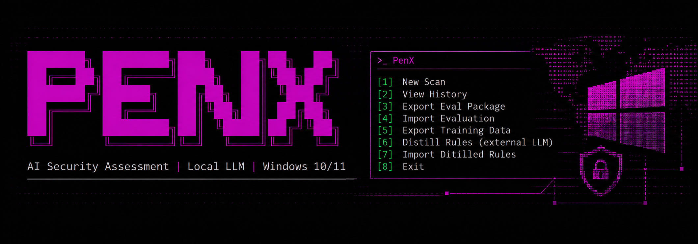
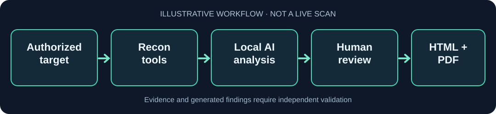

<p align="center">
  
</p>

<h1 align="center">PenX</h1>
<p align="center"><strong>Cross-platform security reconnaissance · Local AI · Evidence-based reporting</strong></p>
<p align="center">
  Open-source security assessment CLI for <strong>Windows, Kali Linux, Debian and Ubuntu</strong>.
  Combine Nmap, Nuclei, HTTPx, ffuf, Katana and more with optional local AI review.
</p>

<p align="center">
  <a href="https://github.com/spk-c/PenX/releases/latest"></a>
  <a href="https://github.com/spk-c/PenX/actions/workflows/ci.yml"></a>
  <a href="https://github.com/spk-c/PenX/actions/workflows/linux-packaging.yml"></a>
  <a href="LICENSE"></a>
  
  
</p>

<p align="center">
  <a href="#download"><strong>Download</strong></a> ·
  <a href="#quick-start">Quick start</a> ·
  <a href="#supported-scanners">Scanners</a> ·
  <a href="#local-ai-and-privacy">Local AI</a> ·
  <a href="#reports-and-exports">Reports</a> ·
  <a href="#documentation">Docs</a>
</p>

> [!IMPORTANT]
> **Authorized assessments only.** PenX makes real network requests. Scan only systems you own or have explicit permission to test. Scanner evidence, AI recommendations and CVE candidates are **not proof of an exploitable vulnerability**.

## Download

**Latest published release: [PenX v0.6.0](https://github.com/spk-c/PenX/releases/tag/v0.6.0)** — ready-to-run builds for Windows and Linux amd64.

| Platform | Edition | Download |
| --- | --- | --- |
| **Windows 10/11 (x64)** | **Installer (recommended)** | [PenX-Setup-x64.exe](https://github.com/spk-c/PenX/releases/download/v0.6.0/PenX-Setup-x64.exe) |
| Windows (x64) | Portable ZIP | [PenX-Windows-x64.zip](https://github.com/spk-c/PenX/releases/download/v0.6.0/PenX-Windows-x64.zip) |
| **Kali / Debian / Ubuntu (amd64)** | **Debian package** | [penx_0.6.0_amd64.deb](https://github.com/spk-c/PenX/releases/download/v0.6.0/penx_0.6.0_amd64.deb) |
| Linux (x86-64) | Portable TAR.GZ | [PenX-Linux-x86_64.tar.gz](https://github.com/spk-c/PenX/releases/download/v0.6.0/PenX-Linux-x86_64.tar.gz) |

**Verify downloads:** [Windows SHA-256 checksums](https://github.com/spk-c/PenX/releases/download/v0.6.0/SHA256SUMS.txt) · [Linux SHA-256 checksums](https://github.com/spk-c/PenX/releases/download/v0.6.0/SHA256SUMS-Linux.txt) · [Full release notes](https://github.com/spk-c/PenX/releases/tag/v0.6.0).

> [!NOTE]
> GitHub's automatically generated **Source code (zip/tar.gz)** files are not the packaged application. External scanner binaries, Npcap and AI models are **not bundled**. Prebuilt ARM64 binaries are not available. The Windows installer is **not Authenticode-signed** and may trigger SmartScreen.

## Why PenX?

| Capability | What it does |
| --- | --- |
| **12 scanner adapters** | Coordinate port, service, web, DNS, registration, subdomain and TLS reconnaissance |
| **Windows + Linux** | Native Windows installer/portable app and Linux amd64 Debian/portable builds |
| **Optional local AI** | Connect to a compatible OpenAI-style endpoint running your own model |
| **Evidence-based findings** | Review raw scanner observations, limitations, CVE candidates and human corrections |
| **Scope and consent** | Passive-only preset, bounded active scans with confirmation, separate opt-in endpoint mapping |
| **Reports and history** | Saved assessments, comparisons, HTML/PDF reports, JSON and SARIF 2.1.0 exports |

PenX is a **terminal/CLI application**, not a graphical dashboard, exploitation framework or vulnerability guarantee. It is an independent cross-platform adaptation of the MIT-licensed [METATRON project](https://github.com/sooryathejas/METATRON).

## Quick start

### Windows: installer or portable

1. Download the Windows installer or ZIP [above](#download), and verify its SHA-256.
2. Install PenX, **or extract the entire ZIP**, keeping `PenX.exe` and the `_internal` directory together.
3. Start PenX and follow the optional scanner setup. Some dependencies require internet, `winget`, or UAC approval (for example Npcap).
4. Optionally connect a local AI endpoint; no model is included.
5. Choose **[1] New Scan**, supply a target you are authorized to assess, then choose tools and review evidence.

Useful Windows commands (from the extracted `PenX` folder):

```powershell
.\PenX.exe --version
.\PenX.exe --setup-status  # Local status; does not scan
.\PenX.exe --check         # Diagnostics
.\PenX.exe --llm-setup     # Optional local AI configuration
```

**Installer data** is stored separately under `%LOCALAPPDATA%\PenX`. Portable installations keep their data next to the extracted application. See the [Windows installation and troubleshooting guide](WINDOWS.md).

### Kali Linux / Debian / Ubuntu: Debian package

Download `penx_0.6.0_amd64.deb` and verify its checksum first:

```bash
sudo apt install ./penx_0.6.0_amd64.deb
penx --version
penx --setup-status
penx --check
penx --setup             # Create private per-user configuration
penx                     # Open the terminal application
```

Or extract the [portable Linux archive](https://github.com/spk-c/PenX/releases/download/v0.6.0/PenX-Linux-x86_64.tar.gz) and run `./PenX/PenX`. The system package does **not** install third-party scanners, start a service or download models. Follow [LINUX.md](LINUX.md) for optional scanner installation, supported distros, glibc compatibility, XDG paths and known limitations.

### From source (Windows or Linux)

PenX supports **Python 3.10–3.13** for source installation (3.13 recommended).

```bash
git clone https://github.com/spk-c/PenX.git
cd PenX
# Linux / Kali:
bash ./install-linux.sh
.venv/bin/penx --version
```

On Windows instead, run `install-windows.bat`, followed by `start-windows.bat`. For scanners on supported apt-based distributions, `bash ./install-linux.sh --with-scanners` is an explicit opt-in and may request sudo. **Never run scanners against unauthorized targets.**

Further CLI workflows: [guided mode](docs/GUIDED_MODE.md), [headless JSON/SARIF](docs/HEADLESS_SCANS.md), [scanner configuration](docs/SCANNER_CONFIGURATION.md), [named project scopes](docs/PROJECT_SCOPE.md), [evidence traceability](docs/EVIDENCE_TRACEABILITY.md), and [verified backup/restore](docs/BACKUP_RESTORE.md).

## How PenX works

```text
Authorized target
      |
      v
Select scope + scanners  -->  Collect evidence
                                     |
                           Optional local AI / CVE research
                                     |
                                     v
                           Human review and corrections
                                     |
                                     v
                       Saved history / scan comparison
                                     |
                              HTML / PDF / JSON / SARIF
```

[](docs/DEMO.md)

*Illustration only; [the demo](docs/DEMO.md) can generate synthetic reports without a live scan.*

## Supported scanners

**12 scanner adapters**, plus **[e] endpoint mapping** as a separate opt-in workflow. Missing tools, permission errors and incomplete results are reported explicitly rather than marked successful.

| Key | Scanner | Purpose |
| :---: | --- | --- |
| `1` | **Nmap** | Ports, services and product/CPE evidence |
| `2` | **WHOIS** | Registration metadata |
| `3` | **WhatWeb** | Web technology fingerprints |
| `4` | **HTTP headers** | HTTP and security header inspection |
| `5` | **DNS** | DNS record lookups |
| `6` | **Nikto** | Web-server assessment checks |
| `7` | **Nuclei** | HTTP/TLS template checks with consent |
| `8` | **ProjectDiscovery HTTPx** | HTTP probing and technology details |
| `9` | **ffuf** | Bounded path discovery |
| `s` | **Subfinder** | Passive subdomain inventory |
| `c` | **Katana** | Bounded crawling |
| `d` | **TLS check** | Certificate and TLS handshake checks |
| `e` | **Endpoint mapping** *(separate)* | Same-origin Katana → ffuf workflow |

Presets: `0` passive-only, `a` standard (tools 1–5), `n` standard + Nikto, `x` full (12 adapters, active-scan consent). Endpoint mapping is **not** included in the full preset. Passive providers can still contact external lookup services; "passive" does not mean offline.

[Scanning, scope and safety details](docs/SCANNING_AND_REPORTS.md) · [Scanner dependency configuration](docs/SCANNER_CONFIGURATION.md).

## Local AI and privacy

PenX connects to an **OpenAI-compatible model endpoint** you configure, such as Ollama, LM Studio, llama.cpp, NInfer, vLLM, SGLang or another compatible server. Local models are optional and are **not included**.

- **Local inference is not automatically fully offline.** Dependency installation, active scanners, optional WHOIS/RDAP/CVE/web lookups and some provider integrations contact external services.
- **CVE matching is research assistance**, not verified exploitation or remediation. Review product/version context and authoritative advisories.
- **Sensitive data stays your responsibility.** SQLite/MariaDB history, `.env` and reports may contain identifiers or secrets. Exports can contain sensitive values even with `--redact`.
- **Missing scanner evidence must not be replaced by model guesses.** Review the original evidence and limitations before acting.

[Local AI setup and CVE research](docs/LOCAL_AI_AND_CVE.md) · [Human review workflow](docs/LOCAL_REVIEW.md) · [Offline AI finding fixture benchmark (PX-403)](docs/AI_EVAL_BENCHMARK.md).

## Reports and exports

After a committed assessment, PenX can produce **HTML and PDF** reports; saved sessions support **JSON and SARIF 2.1.0** exports. Use **[2] View History** to review findings, regenerate reports and manage saved assessments, or **[9] Scan Diff & Trends** for comparisons.

From an installed source environment on Linux:

```bash
.venv/bin/penx --export-session 32 --format json --redact
.venv/bin/penx --export-session 32 --format sarif --redact
```

Replace `32` with an actual saved session ID. `--redact` masks selected fields only; **inspect reports before sharing**. For synthetic HTML/PDF examples without scanning or AI calls, run `python scripts/generate_demo_report.py`.

[Reports and exports](docs/SCANNING_AND_REPORTS.md) · [Sample report demo](docs/DEMO.md).

## PHP2Shell advisory: non-exploiting checks

PenX can compare **already observed PHP version evidence** against published upstream PHP security fixes and report a cautious PHP2Shell release-posture assessment. It can also review previously collected local PHP configuration/log evidence. These checks **do not execute an exploit**, prove RCE, or establish that a vendor-patched or backported installation is vulnerable. Report statuses include `POTENTIALLY_VULNERABLE` and `UNVERIFIED`; neither substitutes for authenticated server-side verification.

[Detection scope and known limitations](docs/SCANNING_AND_REPORTS.md#php2shell-release-posture-offline-advisory) · [Non-destructive lab guide](docs/PHP2SHELL_LIVE_LAB.md).

## Safety and limitations

> [!CAUTION]
> PenX is intended for **authorized defensive research only**. Automation and AI suggestions are not substitutes for independent verification. **Independent field acceptance is NOT SIGNED OFF** for all Windows/Npcap hardware, real-world upgrades, external services, distributions and recovery scenarios.

The v0.6.0 release passed Windows and Kali build/packaging tests, including controlled scanner-adapter checks on Kali. These do **not** establish accuracy or reliability for arbitrary live hosts. See the [Kali acceptance record](docs/LINUX_ACCEPTANCE_2026-11-02.md) and [maintenance status](docs/MAINTENANCE_STATUS.md). Scoop and WinGet manifests are **drafts**, not community registry listings.

## Documentation

| Guide | Covers |
| --- | --- |
| [Windows](WINDOWS.md) | Setup, installer, portable data, updates and troubleshooting |
| [Linux / Kali](LINUX.md) | Debian package, portable archive, dependencies and XDG storage |
| [Scanning & reporting](docs/SCANNING_AND_REPORTS.md) | Scanner behavior, scope, evidence and reports |
| [Backup & restore](docs/BACKUP_RESTORE.md) | Verified backups, restore preview and user-approved restore |
| [Local AI & CVE](docs/LOCAL_AI_AND_CVE.md) | Model endpoints, candidate advisories and provider limits |
| [Demo](docs/DEMO.md) | Illustrative workflow and safe synthetic sample reports |
| [Development](docs/DEVELOPMENT.md) | Architecture, tests and CI |
| [Development roadmap](docs/ROADMAP.md) | 36 prioritized features, architecture targets and acceptance criteria for Codex |
| [Codex execution guide](docs/CODEX_EXECUTION.md) | First sprint, small PR workflow and test checklist |
| [Packaging](docs/PACKAGING.md) | Verified GitHub assets, draft Scoop/WinGet/PyPI workflow |
| [Maintenance](docs/MAINTENANCE_STATUS.md) | Released versions, CI evidence and acceptance limits |
| [Contributing](CONTRIBUTING.md) | Changes, tests and PR guidelines |
| [Security policy](SECURITY.md) | Authorized use and private vulnerability reporting |

## Contributing and license

Contributions are welcome. Please read [CONTRIBUTING.md](CONTRIBUTING.md) and run `python offline_tests.py`. Do not submit customer data, scan records, private keys or model credentials. Report PenX vulnerabilities privately via [SECURITY.md](SECURITY.md).

PenX is licensed under [MIT](LICENSE) and is an independent cross-platform adaptation of [METATRON by Soorya Thejas](https://github.com/sooryathejas/METATRON), not an official upstream release. Third-party scanners have their own licenses.

<p align="center">
  <strong>Find PenX useful?</strong>
  <a href="https://github.com/spk-c/PenX/stargazers">Star the project</a> ·
  <a href="https://github.com/spk-c/PenX/releases">Releases</a> ·
  <a href="https://github.com/spk-c/PenX/issues">Report an issue</a>
</p>
